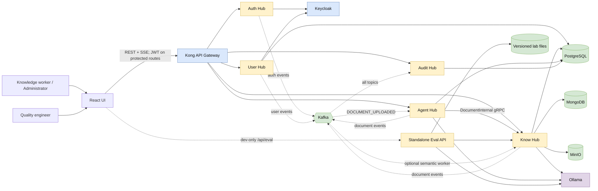

# Brainwave high-level architecture

## 1. Executive view

Brainwave is a self-hosted knowledge and retrieval platform built as a React
single-page application, an API gateway, five domain services, an event-driven
audit/indexing backbone, and local AI infrastructure.

The primary runtime path is:

```text
Browser → Kong → domain service → owned datastore
                    │
                    └─ best-effort domain event → Kafka → Audit Hub
```

Kong is the intended public security boundary. On protected routes, it validates
JWTs against a statically configured Keycloak issuer/public key, adds correlation
and identity headers, and routes REST/SSE traffic to the hubs. Public Auth Hub
routes bypass JWT validation. Services then trust the injected headers. This
boundary is sound only when service and internal gRPC ports are not independently
reachable by an untrusted caller; current development and production Compose
overlays publish several of those ports and therefore do not enforce that
assumption by topology. Staging also sets an external Keycloak hostname while
Kong's static issuer key remains the localhost issuer, so the two must be aligned
before valid staging tokens can pass issuer matching.

Know Hub is the document system of record. It owns metadata, lifecycle,
payloads, objects, embeddings, semantic retrieval, and the original
conversational RAG path. Agent Hub adds corrective RAG and adaptive ingestion,
but delegates all document/vector writes back to Know Hub through an internal
gRPC contract. Audit Hub materializes events from all domain topics into an
append-only query model.

The Evaluation Lab is intentionally separate from the normal platform. In
local development, Vite proxies `/api/eval` directly to a localhost-only Eval
API. That process uses a file-backed experiment store and talks directly to
Know Hub and Ollama. It does not use Kong, Keycloak, Auth Hub, User Hub, Audit
Hub, or the normal Agent Hub service.

Detailed editable views:

- [System context](system-context.drawio)
- [Components and interactions](component-diagram.drawio)
- [Business and evaluation data flows](data-flow.drawio)
- [Deployment topology](deployment-diagram.drawio)

## 2. Architecture at a glance



## 3. Runtime building blocks

| Building block | Runtime responsibility | Owned state and principal dependencies |
|---|---|---|
| **UI** (`:5173` in development) | React/Vite SPA for identity, users, documents, semantic search, chat, corrective reasoning, governance, audit, and evaluation. | Browser state; bearer and refresh tokens are persisted in `localStorage`. Vite proxies normal `/api` traffic to Kong and `/api/eval` to the Eval API. |
| **Kong** (`:8000`) | DB-less edge gateway; RS256 JWT validation, route selection, identity/role header injection, rate limits, CORS, request limits, response headers, correlation IDs, and SSE pass-through. | Declarative `infra/kong/kong.yml`; pre-seeded Keycloak issuer public key. |
| **Keycloak** (`:8080`) | Identity source of truth, credentials, sessions, token issuance, and runtime realm roles. | Development uses local development storage; staging configures PostgreSQL; the current production overlay explicitly uses Keycloak `dev-file` storage. |
| **Auth Hub** (`:3000`, optional gRPC `:50051`) | Stateless Keycloak facade for login/logout/refresh, password flows, token introspection/JWKS/local validation, and auth audit events. | No owned application database. Calls Keycloak and emits `brainwave.auth.events`. The gRPC validation service exists, but User Hub and Know Hub do not wire it into active routes. |
| **User Hub** (`:3001`) | User lifecycle, local roles/permissions, and admin-driven identity provisioning. | PostgreSQL `user_management`; calls Keycloak Admin REST for user creation/deletion compensation; emits `brainwave.user.events` directly from handlers. A `UserPreference` model exists, but no active application/repository/HTTP path exposes it. |
| **Know Hub** (`:3002`, gRPC `:50052`) | Document/note lifecycle, idempotent upload saga, object/payload storage, semantic indexing/search, chat RAG, and the authoritative internal document API. | PostgreSQL `doc`, `sem`, and `chat`; MongoDB payloads/notes; MinIO binaries; Ollama; Kafka; optional Langfuse. |
| **Agent Hub** (`:3004`) | Corrective RAG over SSE, runtime governance, run trajectories/checkpoints, and Kafka-driven adaptive ingestion. | PostgreSQL `agent`; gRPC to Know Hub; Kafka; Ollama; optional Langfuse and local cross-encoder. It is not the document system of record. |
| **Audit Hub** (`:3003`) | Kafka consumer and read-only audit query model. | Consumes all three domain topics and idempotently appends to PostgreSQL `audit.audit_events`. |
| **Eval API** (`127.0.0.1:3005`, development only) | Dataset construction, indexing, retrieval/generation evaluation, judge calibration, experiments, statistical analysis, and release-gate decisions. | Versioned JSON/JSONL file store; direct HTTP/gRPC to Know Hub; direct HTTP to Ollama; in-process background jobs. |
| **Core library** | Shared compile-time/runtime library for TypeScript hubs: errors, HTTP middleware, structured logging, telemetry, gRPC helpers, semantic primitives, and Kafka contracts. | Published package/local workspace dependency; not an independently deployed service. |

### Shared platform services

| Capability | Components | Use |
|---|---|---|
| Event backbone | Kafka (KRaft) | Three topics: `brainwave.auth.events`, `brainwave.user.events`, and `brainwave.document.events`. |
| Relational/vector persistence | PostgreSQL 16 + pgvector | Schema-per-service data plus the separate Langfuse database and, in staging, Keycloak's database. |
| Document payload/object storage | MongoDB + MinIO | MongoDB holds structured payloads and notes; MinIO holds binary objects. A document uses one primary payload store in addition to PostgreSQL metadata. |
| Local model runtime | Ollama | `nomic-embed-text` embeddings and a local Llama reasoning/generation model. Document text is kept inside the deployment network. |
| LLM operations | Langfuse | Best-effort prompt lookup and traces when enabled. Know Hub enables it in the depicted development profile; Agent Hub has the integration but development disables it. |
| Metrics, logs, traces | Prometheus, Alertmanager, Promtail, Loki, OpenTelemetry Collector, Tempo, Grafana, exporters | Prometheus directly scrapes Kong, Auth/User/Know/Audit, collector endpoints, and infrastructure exporters; Promtail ships container stdout directly to Loki. In development, Auth/User/Know/Audit export OTLP traces through the collector to Tempo. Collector metrics/log pipelines are configured capabilities, not verified application flows. Agent Hub has no current Prometheus scrape target or OTel configuration. |

## 4. Runtime interaction matrix

| Source | Destination | Contract | Purpose |
|---|---|---|---|
| Browser/UI | Kong | HTTP REST and SSE under `/api/*`; bearer JWT on protected routes, with public Auth/system exceptions | Auth, users, documents, search, Know Hub chat, Agent Hub reasoning/governance, and audit queries. |
| Kong | Auth/User/Know/Agent/Audit Hubs | HTTP; injected `X-User-Id`, `X-User-Name`, `X-User-Roles`, `X-Correlation-Id` as applicable | Edge authentication, identity propagation, routing, and streaming. |
| Auth Hub | Keycloak | OIDC/OAuth2 and Admin REST | Tokens, introspection, JWKS, logout URLs, password and account flows. |
| User Hub | Keycloak | Admin REST | Create identity before local user record; compensate in Keycloak if the local write fails. |
| Browser/UI | MinIO | Direct HTTP GET using a Know Hub presigned URL | Download binary objects without streaming them through Know Hub; the signed endpoint must be browser-resolvable. |
| Agent Hub | Know Hub | Insecure internal gRPC `DocumentInternal` | `SemanticSearch`, `GetPayload`, `PersistChunks`, and `UpdateMetadata`. |
| Know Hub / Agent Hub / Eval API | Ollama | HTTP | Embeddings, grading, query rewriting, generation, grounding checks, classification, and evaluation judging. |
| Auth/User/Know/Agent Hubs | Kafka | Domain event envelope | Best-effort audit events; document upload/indexing trigger. |
| Kafka | Audit Hub | Consumer group `brainwave.audit-hub` | Materialize all domain events into the audit read model. |
| Kafka | Agent Hub | Consumer group `brainwave.agent-hub.ingestion-crew` | Adaptive document ingestion in the normal development profile. |
| Kafka | Know Hub | Consumer group `brainwave.know-hub.semantic-worker` | Fixed-chunk semantic ingestion when enabled: production inherits the enabled default and Eval enables it explicitly. Staging intends the same ownership, but the committed staging application overlay is currently boot-blocked by invalid service environment wiring. |
| Know Hub | Langfuse | HTTP, optional/fail-open | RAG system prompt and chat traces. |
| Agent Hub | Langfuse | HTTP, optional/fail-open | Versioned reasoning prompts and graph traces when enabled; the depicted development configuration disables this integration. |
| Auth/User/Know/Audit Hubs (development only) | OTel Collector | OTLP traces | Export traces to the collector and Tempo. Agent Hub is not configured for this path, and the staging/production service commands do not load the telemetry bootstrap or supply the development OTEL environment. |
| Prometheus | Kong, Auth/User/Know/Audit Hubs, OTel collector endpoints, and exporters | HTTP scrape | Pull gateway, application, telemetry-pipeline, and infrastructure metrics; Agent Hub is not a configured target. |
| Promtail | Container stdout, then Loki | Docker discovery and HTTP push | Ship container logs independently of the OTel path. |
| Vite UI | Eval API | Direct HTTP `/api/eval`, dev-only | Bypasses the standard gateway and login in the lean local evaluation stack. |

### Implemented but not active

| Declared integration | Current state |
|---|---|
| User Hub / Know Hub → Auth Hub `ValidateToken` gRPC | Clients and middleware exist, but the active routers do not install them. JWT verification happens at Kong. |
| User Hub transactional outbox → Kafka | `user_events` rows and repository methods exist, but no dispatcher runs. Handler-level Kafka publishing is the active path. |
| User Hub role/permission catalogue → runtime authorization | Not connected. Kong reads Keycloak realm roles; Know Hub uses its own static role-to-permission map. |
| `DOCUMENT_CLASSIFIED` event | Declared in contracts but not emitted by the current Agent Hub ingestion path. |

## 5. Data ownership and consistency boundaries

| Owner | Durable data | Notes |
|---|---|---|
| Keycloak | Identities, credentials, sessions, realm roles | Runtime roles used by Kong are sourced from the JWT, not User Hub's role tables. |
| User Hub | `user_management.users`, roles, permissions, assignments, the currently unexposed preference model, `user_events` | The outbox table is durable but currently undrained; preference persistence has no active service/API path. |
| Know Hub | `doc.documents`, lifecycle and idempotency; `sem.document_chunks`; `chat.*`; Mongo payloads/notes; MinIO objects | Metadata is authoritative; chunks are derived/regenerable. Payloads are stored in MongoDB **or** MinIO, not necessarily both. |
| Agent Hub | `agent_runs`, `agent_steps`, `agent_governance`, LangGraph checkpoints | Checkpoints can contain the full question, retrieved chunks, and generated answer even though step summaries are redacted. |
| Audit Hub | `audit.audit_events` | Append-only application role; unique event ID makes the consumer replay-tolerant. |
| Eval API | Versioned datasets, corpus, golden items, indexes, experiments, retrieval/generation runs, annotations, judges, and gate artifacts | File-backed and development-focused. Job progress and the derived experiment-report cache are in process memory; offline harness reports are separate repository files. |
| Langfuse | Prompts and LLM traces in its own PostgreSQL database | Full prompts/context/answers can be present when tracing is enabled. |

Cross-service table access is avoided. Services that share the PostgreSQL
instance use distinct roles/schemas, and Agent Hub delegates document/vector
writes to Know Hub rather than connecting to `doc` or `sem` directly.

## 6. Principal data flows

### 6.1 Login and an authenticated request

1. The UI calls the public Auth Hub route through Kong.
2. Auth Hub calls the Keycloak token endpoint and returns the token set.
3. The UI stores the tokens and sends the access token on later requests.
4. Kong validates signature and expiry, derives the Keycloak subject and
   platform roles, and sets trusted upstream headers plus a correlation ID.
5. The selected service trusts those headers and performs its owned data
   operation. Authorization is route-specific and incomplete: User Hub does
   not install role enforcement, and Audit Hub's all-activity handler does not
   require `ADMIN`.
6. Material actions may publish an event to Kafka without delaying the HTTP
   response; Audit Hub later persists it.

Auth Hub token and system routes are also public in the current Kong
configuration. The `/api/tokens/*` routes should therefore be treated as an
explicit public surface, not an internal one.

Current UI logout is local-only in practice. It calls Auth Hub without an ID
token hint, ignores the returned Keycloak end-session URL, and clears browser
state; the upstream Keycloak session is not terminated by that flow.

### 6.2 Document upload and asynchronous indexing

1. `POST /api/documents` reaches Know Hub after Kong validation and the
   `document:create` permission check.
2. Know Hub acquires an idempotency record, inserts document metadata in state
   `RECEIVED`, and records lifecycle transitions to `PERSISTING`.
3. Structured content is written to MongoDB; binary content is written to the
   MinIO hot bucket.
4. Know Hub transitions the document to `AVAILABLE`, records the lifecycle row,
   and completes the idempotency key.
5. After persistence, the handler starts a fire-and-forget
   `DOCUMENT_UPLOADED` publish to `brainwave.document.events` and sends HTTP
   201 without awaiting Kafka. These are parallel post-persistence effects;
   neither delivery nor their completion order is guaranteed.
6. Exactly one indexing implementation should own a delivered upload event:
    - **Agent ingestion:** get payload over gRPC, extract/classify, choose an
      adaptive chunk strategy, embed with Ollama, and delegate chunk/metadata
      writes back to Know Hub over gRPC. Successful embedding persists
      `INDEXED`; embedder failures can persist `FAILED`. Current graph-only skip
      paths do not call `UpdateMetadata`, so the document can remain `PENDING`.
   - **Know semantic worker:** extract supported text, fixed chunking (512/64),
     embed with Ollama, and write the `sem` schema locally.
7. Audit Hub independently consumes the upload event. When Agent Hub owns
   indexing it also emits `DOCUMENT_INDEXED`, which Audit Hub consumes; the
   local Know Hub worker does not emit an indexing-completion event.

The two indexers use different consumer groups; Kafka therefore sends the same
upload to both when both are enabled. Configuration—not Kafka—must enforce
mutual exclusion. Full development disables the Know Hub worker and runs the
Agent Hub crew. Production omits Agent Hub and inherits Know Hub's enabled
worker default. The Eval profile also omits normal Agent Hub and explicitly
enables the Know Hub worker. Staging is intended to use the local worker, but
its committed application overlay cannot currently start User/Know/Audit due
to invalid environment wiring; it is not an operational indexing profile.

For binary download, Know Hub returns a presigned MinIO URL and the browser
opens it directly. The current signing host is the container DNS name `minio`,
which is normally not resolvable by a host browser; deployments need a
browser-reachable external MinIO endpoint or URL rewriting.

### 6.3 Search, Know Hub chat, and corrective Agent chat

**Semantic search** embeds the query with Ollama, uses an in-process vector
cache, and searches `sem.document_chunks`. HTTP supports pure-vector and hybrid
modes and returns a best excerpt per document; hybrid mode combines vector ANN
and PostgreSQL full-text search using reciprocal-rank fusion. The internal gRPC
search is vector-only and returns individual chunks. SQL applies the owner
predicate unless the caller is an administrator.

**Know Hub chat** owns sessions and messages. It condenses follow-up questions,
retrieves owner-filtered chunks, streams generation from Ollama, then persists
the user turn, assistant turn, and citation rows in `chat.*`. It is a direct RAG
path under `/api/chat`.

**Agent Hub chat** is the corrective RAG path under `/api/agent/chat`. It creates
an agent run, reads the cached governance profile, retrieves chunks from Know
Hub over gRPC, optionally reranks them locally, grades relevance, optionally
rewrites and retrieves again, generates through Ollama, checks grounding, and
streams graph/answer events over SSE. It persists the run, redacted step
summaries, governance, and LangGraph checkpoints in the `agent` schema.

### 6.4 Evaluation Lab

1. In local development, Vite sends `/api/eval` directly to `127.0.0.1:3005`.
2. Eval API stores versioned datasets and experimental artifacts on its local
   file-backed LabStore.
3. Index jobs upload corpus documents directly to Know Hub with synthetic owner
   and role headers, then poll embedding state. The Eval Compose profile enables
   the Know Hub semantic worker.
4. Evaluation uses HTTP for document-level hybrid/vector search and gRPC for
   chunk-level vector search.
5. Generation and judge flows call the local Ollama runtime. Durable run,
   annotation, judge, and gate artifacts are written to LabStore; derived
   experiment reports are cached in process, while offline harness reports are
   separate repository files.
6. A slim policy/baseline/candidate snapshot can be exported for the CI release
   gate.

The normal Agent Hub service is intentionally absent from this profile. The
evaluation runner imports its code in-process where needed, avoiding a second
Kafka ingestion consumer.

## 7. Trust boundaries

1. **Browser / untrusted network.** Bearer tokens and user input originate here.
2. **Gateway identity boundary.** On protected routes, Kong validates JWTs and
   produces the identity headers trusted by services. Service HTTP handlers
   generally do not revalidate the token. Staging's external Keycloak issuer
   currently differs from Kong's static localhost issuer key and must be
   reconciled.
3. **Application network.** Direct access must be restricted. Several services
   will accept spoofable `X-User-*` headers, and their fallback JWT parsing
   decodes claims without verifying the signature.
4. **Internal gRPC data plane.** Know Hub `:50052` uses insecure gRPC with no
   service authentication. `SemanticSearch` trusts the caller-supplied actor and
   admin flag; `GetPayload` does not enforce its actor field; chunk/metadata RPCs
   are privileged writes.
5. **Persistence boundary.** PostgreSQL schemas/roles prevent accidental
   cross-service table use; Know Hub remains the sole document/vector writer.
6. **Local AI boundary.** Questions, document chunks, prompts, and answers flow
   to self-hosted Ollama. When Langfuse is enabled, prompt/context/answer data
   also enters the self-hosted tracing store.
7. **Evaluation exception.** Eval API intentionally bypasses gateway identity
   only on the localhost-bound lean development stack.

## 8. Deployment profiles

| Profile | Included shape | Architectural consequence |
|---|---|---|
| `make dev` | Base infrastructure and observability; no app-service profile | Shared stores, gateway, identity, Kafka, Ollama, and monitoring only. |
| `make dev-services` | Full `services` profile, including all five hubs | Agent Hub owns adaptive ingestion because Know Hub's dev semantic worker is disabled. UI still runs separately. |
| `make staging` | Base infrastructure plus the observability overlay; no `services` profile | Starts stores, identity, gateway, Kafka, Ollama, and monitoring, but no application hubs. |
| `make staging-services` | Declares staging infrastructure/observability plus Auth/User/Know/Audit | **Not currently bootable as a complete application tier:** User Hub omits `DATABASE_URL`; Know Hub receives incompatible database/MinIO variable names; and Audit Hub sets an unsupported `NODE_ENV=staging`. Agent Hub is also absent even though Kong declares its route. Service/store ports are mostly loopback-bound. |
| `make prod` | Base infrastructure plus the observability overlay; no `services` profile | Starts production infrastructure and monitoring, but no application hubs. |
| `make prod-services` | Production infrastructure/observability plus Auth/User/Know/Audit prebuilt images | Agent Hub is absent and Know Hub's local semantic worker inherits its enabled default. Several service/store, Keycloak, and Kong Admin ports are publicly published unless the host firewall compensates. |
| `make evals-lab` | PostgreSQL, MongoDB, MinIO, Kafka, Ollama, Know Hub, and Eval API | No Kong, Keycloak, Auth/User/Audit Hub, observability stack, or normal Agent Hub. Know Hub semantic worker is enabled. |
| evaluation runners | One-shot Eval and isolated RAGAS containers | Import application code and write reports; RAGAS has a separate environment because of dependency conflicts. |

UI is not defined in the main Docker Compose files. It is a separate Vite
process in development and needs an independent production hosting/CDN decision.

## 9. Reliability and consistency model

- **HTTP persistence precedes audit publication.** Auth/User/Know events are
  mostly fire-and-forget. A Kafka outage can therefore leave committed business
  data without a matching audit/index trigger.
- **Audit consumption is replay-tolerant, not end-to-end transactional.** The
  unique event ID removes duplicate rows, but producer commits and Kafka writes
  are not atomic.
- **Agent ingestion is replay-tolerant, not exactly-once.** Consumer offsets,
  Know Hub writes, and completion events are not in one transaction. Replacing
  chunks makes replay safer.
- **Upload availability and searchability are separate.** A document becomes
  `AVAILABLE` before derived embeddings are ready. The local worker progresses
  through `PENDING` and `INDEXING` to `INDEXED`, `SKIPPED`, or `FAILED`; Agent
  ingestion persists `INDEXED`/`FAILED` from its embedder path, while skip or
  earlier failure paths can leave the Know Hub state at `PENDING`.
- **Optional AI/observability features fail open in several paths.** Reranking
  and Langfuse tracing can fall back, but Agent Hub currently creates its entire
  request context as one unit: Postgres or Kafka startup failure can make agent
  routes return 503.

## 10. Current-state findings and recommended decisions

This is an architecture review of the observed repositories, not a statement
that every item below is already remediated.

| Priority | Finding | Recommended architectural decision |
|---|---|---|
| P0 | The platform trusts gateway-injected headers while development and production publish service ports directly. User Hub mutating/admin routes and Audit Hub's all-activity route lack service-side role enforcement. | Make Kong/load balancer the only untrusted ingress, bind internal ports privately, and enforce authorization in each service as defense in depth. |
| P0 | Know Hub's privileged gRPC data plane is unauthenticated and trusts caller-supplied identity; `GetPayload` ignores the actor. | Add service identity (mTLS or workload token), interceptors/authorization, and owner checks for every read/write RPC. |
| P0 | Staging configures an external Keycloak issuer hostname while Kong's static JWT consumer key remains `http://localhost:8080/realms/brainwave`. | Generate gateway issuer/JWT configuration per environment and add an end-to-end staging token test before promotion. |
| P0 | The committed `staging-services` overlay cannot start the complete app tier: User Hub lacks `DATABASE_URL`, Know Hub receives unsupported database/MinIO variable names, and Audit Hub rejects `NODE_ENV=staging`. | Define one validated environment contract per service, map Compose variables to it explicitly, and make full-profile config/startup smoke tests a release gate. |
| P1 | Staging/production and the image-publish workflow omit Agent Hub while Kong exposes `/api/agent`. | Decide whether Agent Hub is production scope. If yes, publish/deploy it and its health dependencies; if no, remove or feature-gate the route/UI. |
| P1 | Index ownership is a configuration invariant. Both consumer groups will process every upload if enabled, while manual reindex always uses the local fixed-chunk pipeline. | Make the active indexer an explicit single setting, refuse invalid dual-worker startup, and route reindex through the selected pipeline. |
| P1 | Domain-event publishing is best-effort. User Hub's transactional outbox has no dispatcher and Know Hub has no outbox. | Standardize on a real outbox/CDC pattern or explicitly accept and monitor audit/index gaps. |
| P1 | Runtime authorization roles come from Keycloak, while User Hub edits separate PostgreSQL roles and Know Hub uses a static permission map. | Select one authorization source of truth and propagate changes atomically/cacheably to every decision point. |
| P1 | Kong's Agent Hub route omits `PUT`, but governance updates use `PUT /api/agent/governance`. | Align the gateway method allow-list with the live API contract and add an integration test through Kong. |
| P1 | The UI's logout flow clears local tokens but neither follows Auth Hub's returned end-session URL nor supplies an ID token hint, so the Keycloak session remains. | Complete RP-initiated logout and test both local token removal and upstream session termination. |
| P1 | Presigned MinIO downloads use the container hostname `minio`, which host browsers normally cannot resolve. | Separate internal and public object-store endpoints and sign browser-facing URLs with the external origin. |
| P1 | The production Keycloak overlay uses `KC_DB=dev-file` instead of the external PostgreSQL setup used by staging. | Move production identity persistence to a supported durable database, back it up, and test restore/failover. |
| P2 | Run/checkpoint and LLM tracing stores can contain full questions, document chunks, prompts, and answers. | Apply explicit data classification, retention, access control, deletion, and redaction policies to checkpoints and Langfuse. |
| P2 | Health/readiness checks do not cover all critical dependencies; one production Know Hub probe targets a route the service does not expose. | Define per-service readiness contracts from actual critical dependencies and continuously test Compose health paths. |
| P2 | Document cleanup/archive and identifier use are inconsistent: archive does not move objects, delete is soft and can retain chunks, and payload keys mix internal/public IDs. | Define lifecycle invariants and one canonical storage key, then add reconciliation and migration tooling. |
| P2 | PostgreSQL full-text vectors use the `english` configuration, limiting the lexical side of Arabic hybrid retrieval. | Make text-search configuration language-aware or use an Arabic-capable lexical strategy and measure it through the existing evaluation harness. |
| P2 | Agent Hub has no current Prometheus scrape target or OTel configuration, and its development Langfuse integration is disabled. | Add consistent Agent Hub metrics/traces and explicitly decide which prompt/context data may enter Langfuse. |

Additional implementation notes:

- Agent Hub's prompt registry caches the first Langfuse resolution for the
  process lifetime; publishing a new label is not currently picked up on the
  next run without restart.
- Agent ingestion declares `DOCUMENT_CLASSIFIED` but does not emit it, and its
  skip/completion status handling does not always update Know Hub consistently.
- The supplied Agent Hub images install the base package, not the optional
  PDF/DOCX extraction dependencies.
- Know Hub's configured 50 MB multer limit is effectively capped by Kong's
  global 25 MB limit.
- Citation document/chunk IDs are logical references; the database does not
  define foreign keys for them.

## 11. Source-of-truth map

Use these files first when refreshing the diagrams:

| Concern | Primary implementation source |
|---|---|
| Gateway routes and identity propagation | `infra/kong/kong.yml` |
| Full/dev/staging/prod/eval deployment | `infra/docker/compose*.yml`, `infra/Makefile`, `infra/env/services/` |
| Event topics and envelope | `core/src/kafka/events.ts`, `infra/kafka/init-topics.sh` |
| Database ownership | `infra/postgres/init/`, service Prisma schemas |
| Auth surface | `auth-hub/src/transport/http/`, `auth-hub/src/transport/grpc/` |
| User surface and identity provisioning | `user-hub/src/transport/http/router.ts`, `user-hub/src/application/user.service.ts` |
| Document/search/chat surface | `know-hub/src/transport/http/router.ts`, `know-hub/src/application/` |
| Internal document RPCs | `know-hub/proto/knowhub.proto`, `know-hub/src/transport/grpc/server.ts` |
| Corrective RAG and ingestion | `agent-hub/src/agent_hub/application/`, `agent-hub/src/agent_hub/transport/` |
| Audit consumer/read model | `audit-hub/src/kafka/consumer.ts`, `audit-hub/src/transport/http/` |
| Eval Lab | `agent-hub/src/agent_hub/eval/lab/`, `infra/docker/compose.evals.yml` |
| UI routing and API clients | `ui/src/api/`, `ui/src/router/`, `ui/vite.config.ts` |
| Observability flow | `infra/docker/compose.observability.yml`, `infra/otel-collector/`, `infra/prometheus/`, `infra/loki/`, `infra/tempo/` |
